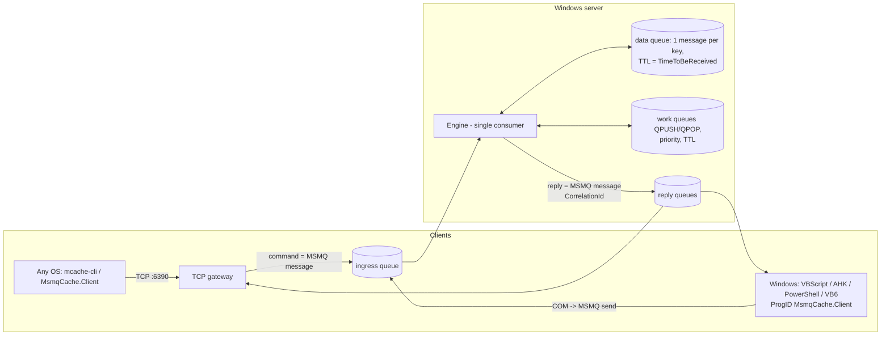

# Msmq-Cache

A cache / queue server whose **backend is MSMQ**. Every command, whether it arrives over **TCP** or through the
**COM** automation object, is first written as a message into an MSMQ ingress queue and executed from there.
Data (keys, TTL, durability) also lives in MSMQ queues. It is *not* a Redis clone with MSMQ bolted on the side.



* Server: Windows only (MSMQ). Clients: TCP from any OS; COM from Windows.
* Docs: `docs/` (Markdown; export to PDF/DOCX/HTML with `docs/build-docs.ps1` or `docs/build-docs.sh`).
* **Read `docs/07-limitations.md` before production use.**

## Quick start
```powershell
# 1. enable MSMQ (admin)
Enable-WindowsOptionalFeature -Online -FeatureName MSMQ-Server -All
# 2. build
dotnet build MsmqCache.slnx -c Release
# 3. run
src\MsmqCache.Server\bin\Release\net48\mcache-server.exe --config conf\mcache.conf
# 4. talk to it
dotnet run --project src/MsmqCache.Cli -- SET greeting hello EX 60
dotnet run --project src/MsmqCache.Cli -- GET greeting
```
COM (elevated): `%windir%\Microsoft.NET\Framework64\v4.0.30319\regasm.exe /codebase MsmqCache.Com.dll`, then
```vbs
Set c = CreateObject("MsmqCache.Client") : c.Connect ".", "mcache"
c.Set "k", "v", 60 : WScript.Echo c.Get("k")
```
License: MIT.

## 👤 Author
        
[Hadi Cahyadi](mailto:cumulus13@gmail.com)
    

[](https://www.buymeacoffee.com/cumulus13)

[](https://ko-fi.com/cumulus13)
 
[Support me on Patreon](https://www.patreon.com/cumulus13)