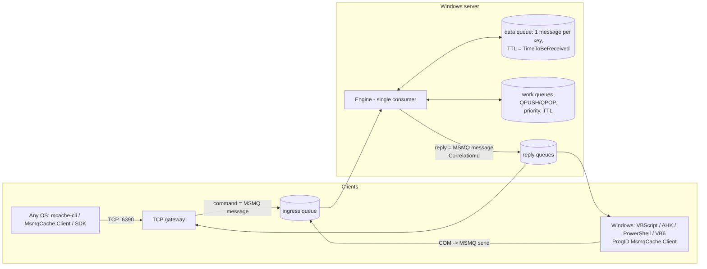

# 1. Overview

MsmqCache is a networked cache and work-queue server in which **MSMQ is the engine**:

| Concern | Provided by |
|---|---|
| Ordering and serialisation of all commands | MSMQ ingress queue (one consumer) |
| Durability | MSMQ recoverable messages / transactional queue (disk backed) |
| Key expiry | MSMQ `TimeToBeReceived` on the message that holds the value |
| Atomic overwrite | MSMQ internal transaction (send new + receive old) |
| Request/reply | MSMQ `ResponseQueue` + `CorrelationId` |
| Work queues, priorities | native MSMQ queues and message priority |
| Back-pressure, quota | MSMQ queue quota (`max-queue-kb`) |
| Access control | MSMQ queue ACLs (COM / remote MSMQ), `requirepass` (TCP) |

## Two ingress paths, one queue
* **TCP**: `mcache-server` listens on a port. The gateway never touches the cache; it wraps each command into an MSMQ message.
* **COM**: the in-process automation object `MsmqCache.Client` sends the same message directly to the ingress queue. There is no separate COM server process; the *queue* is the COM entry point. Works locally or against a remote server's queue via MSMQ.

Both paths produce byte-identical messages (RESP-encoded command in the body), so the engine cannot tell them apart.

## Components
| Project | Target | Role |
|---|---|---|
| `MsmqCache.Core` | netstandard2.0 + net48 | protocol, config parser, MSMQ helpers (net48 only) |
| `MsmqCache.Server` | net48 | `mcache-server.exe` (console or Windows service) |
| `MsmqCache.Com` | net48 | COM automation object, ProgID `MsmqCache.Client` |
| `MsmqCache.Client` | netstandard2.0 | TCP client library, any OS |
| `MsmqCache.Cli` | net8.0 | `mcache-cli`, any OS |

## 👤 Author
        
[Hadi Cahyadi](mailto:cumulus13@gmail.com)
    

 
[Support me on Patreon](https://www.patreon.com/cumulus13)