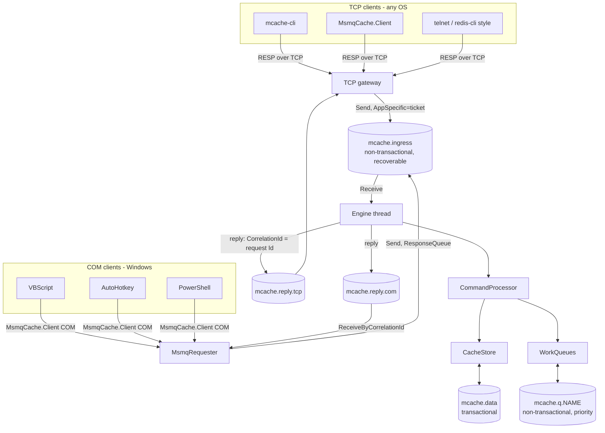
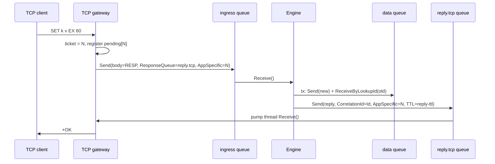
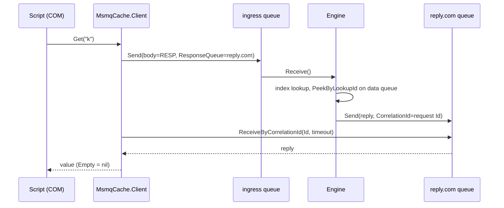
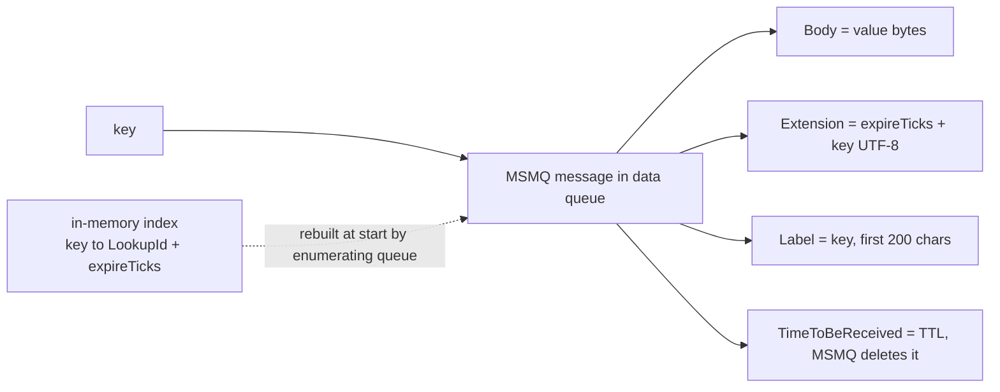
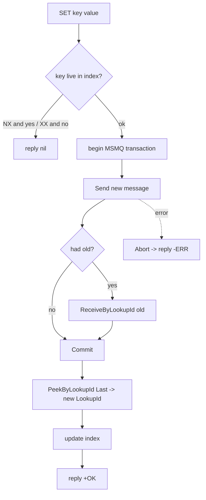
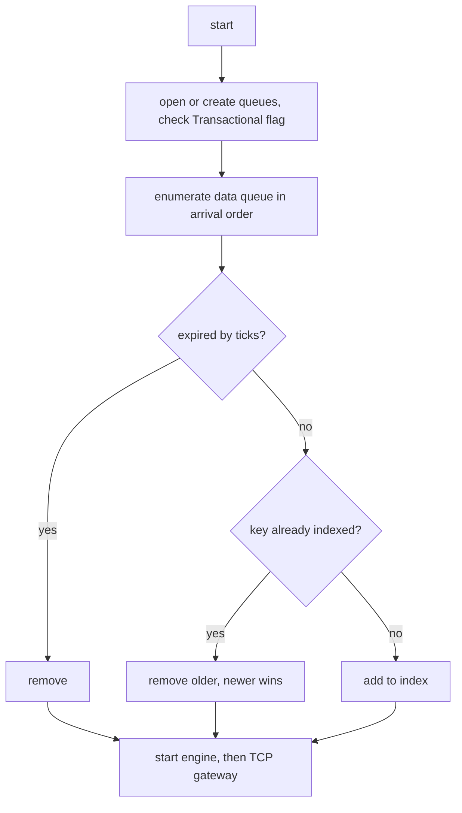

# 2. Architecture

## 2.1 Components and queues

## 2.2 Sequence: TCP

## 2.3 Sequence: COM

## 2.4 Data model (one MSMQ message per key)

## 2.5 SET

## 2.6 Startup recovery

## 2.7 Concurrency model
One engine thread consumes the ingress queue, so all commands are executed in MSMQ arrival order (linearisable, like Redis' single thread). The index is touched only by that thread. TCP clients are handled asynchronously; each connection has at most one command in flight (replies keep request order).
